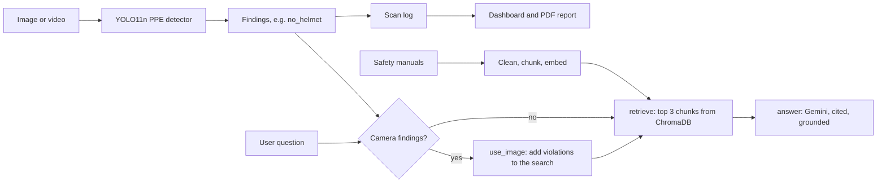

# VisionDesk AI: Multimodal Workplace Safety Assistant

**Spots missing safety gear in site photos and videos, then explains which rule was broken by searching the company's safety manuals. It combines a fine-tuned YOLO detector, RAG over ChromaDB and a LangGraph agent with Gemini, all in a Streamlit dashboard with PDF compliance reports.**


## The problem

- Safety officers on construction sites and in warehouses check PPE by walking around, so most violations go unseen.
- When they do see one, the rule behind it is buried in a long safety manual.
- VisionDesk handles both: the camera finds the violation, and the assistant answers "which rule does this break and what should happen next?" with a citation to the manual.

## What it does

| Page | What you can do |
| --- | --- |
| 👷 PPE Detection | Upload an image or video. Red boxes mark violations, green boxes mark correct gear. |
| 📄 Documents | Upload safety manuals (PDF, TXT, DOCX) and search them by meaning. |
| 🤖 Ask AI | Ask a question, optionally about the last scan. Answers cite the manual as `[file #chunk]`. Rate each answer 👍 or 👎. |
| 📊 Dashboard | Compliance rate, violations by type, scan history and user satisfaction. |
| 📋 Report | Download a PDF compliance report with a Gemini-written summary. |

## How it works



| Step | What I did and why |
| --- | --- |
| Detection | Fine-tuned **YOLO11n** on the Ultralytics Construction-PPE dataset (11 classes). Any class starting with `no` (`no_helmet`, `no_gloves`, `no_goggle`, `no_boots`) counts as a violation. |
| Video | Checks every 5th frame for speed. For each class it keeps the busiest frame, so it **counts people, not frames**. |
| Documents | Extracts text, rejoins hyphenated words, drops page-number lines, then chunks by paragraph (long paragraphs are split into 500 characters with 50 overlap). |
| Knowledge base | `all-MiniLM-L6-v2` embeddings stored in persistent **ChromaDB**. Re-uploading a file replaces its old chunks, so there are no duplicates. |
| Agent | **LangGraph** graph with conditional routing. If there are camera findings, the violation names are added to the search query, so "Is he safe?" retrieves the helmet rule. |
| Grounding | The prompt allows only the retrieved passages, requires `[file #chunk]` citations, and says "Not found in documents" instead of guessing. |
| Fallback | With no API key the app still works: it shows the most relevant passages instead of crashing. |
| Reporting | Gemini writes a 120-word summary grounded in the manual. `fpdf2` builds the PDF. |
| Monitoring | Every scan and every 👍/👎 is logged, which drives the compliance and satisfaction KPIs. |

## Results

**PPE detector** (validation set of 143 images, YOLO11n, 30 epochs, 640 px):

| Metric | Result |
| --- | --- |
| Precision | 0.60 |
| Recall | 0.50 |
| mAP@50 | 0.50 |
| mAP@50-95 | 0.24 |

- This is a small model trained for only 30 epochs on 1,132 images. That's enough to demo the full pipeline, and it's the first thing to improve (see Next steps).

**Retrieval check:** `evaluate.py` asks 10 questions with known answers and passes a question if the right passage is in the top 3 results. The target is 85% or more.

**Tests:** 6 tests cover violation rules, document cleaning, the knowledge base, KPIs, the PDF report and both agent routes. They use fake embeddings and no API key, so they run offline in a few seconds.

## Use the agent from Python

```python
from agent import ask_agent

result = ask_agent(
    "Is this worker following the safety rules?",
    vision="site.jpg: found {'Person': 1, 'no_helmet': 1}. VIOLATIONS: ['no_helmet'].",
    violations=["no_helmet"],
)
result["steps"]    # ['use_image', 'retrieve', 'answer']
result["answer"]   # grounded answer with [file #chunk] citations
```

## Run it

```bash
git clone https://github.com/Praveenasuku/AI-VisionDesk-2.git
cd AI-VisionDesk-2
python -m venv venv && source venv/bin/activate    # Windows: see SETUP_WINDOWS.txt
pip install -r requirements.txt

cp .env.example .env          # add your GEMINI_API_KEY (never commit .env)
streamlit run app.py          # open http://localhost:8501

python -m pytest -q           # 6 tests
python evaluate.py            # retrieval accuracy
python vision.py photo.jpg    # detect PPE in one image, saves output.jpg
```

## Deploy (Streamlit Community Cloud, free)

1. Go to share.streamlit.io, choose **Create app**, and pick `app.py` from this repo.
2. Under **Settings → Secrets**, add `GEMINI_API_KEY = "your_key"`.
3. Click **Deploy**. `packages.txt` installs the system library OpenCV needs, and the sample manual loads automatically on first start.

## Project structure

```
vision.py           YOLO PPE detection for images and video, violation rules, box drawing
documents.py        load PDF/TXT/DOCX, clean, chunk
knowledge_base.py   embeddings + ChromaDB: add, search, list
llm.py              Gemini client (returns None when no key is set)
agent.py            LangGraph agent: route, retrieve, answer
evaluate.py         retrieval accuracy check
storage.py          scan and feedback logs, KPIs
report.py           Gemini summary + PDF compliance report
app.py              Streamlit dashboard (6 pages)
best.pt             fine-tuned YOLO11n PPE model
data/               sample safety manuals
tests/              6 offline tests
```

## Common problems

| Problem | Fix |
| --- | --- |
| `best.pt not found` | Keep `best.pt` in the project folder |
| `GEMINI_API_KEY not set` | Add it to `.env` (locally) or Secrets (Streamlit Cloud) |
| `libGL.so.1` error on Linux | `sudo apt install libgl1` |
| Wrong labels on boxes | Labels come from `best.pt` itself; violations are classes starting with `no` |

## Next steps

- **Better detector:** train for 100+ epochs or use YOLO11s, and add a `no_vest` class (the dataset has none).
- **Better retrieval:** hybrid search (BM25 + vectors) with a reranker, and a larger evaluation set.
- **Production storage:** move the CSV logs to PostgreSQL so several sites and users can share one dashboard.
- **Live cameras:** process an RTSP stream and send an alert when a violation lasts more than a few seconds.

## Credits

- Dataset: [Construction-PPE](https://docs.ultralytics.com/datasets/detect/construction-ppe) by Ultralytics (AGPL-3.0).
- Detector built with [Ultralytics YOLO](https://github.com/ultralytics/ultralytics).

---

**Praveena S**, Generative AI Engineer · [Portfolio](https://praveena-portfolio-two.vercel.app) · [LinkedIn](https://www.linkedin.com/in/praveena-suku/)
